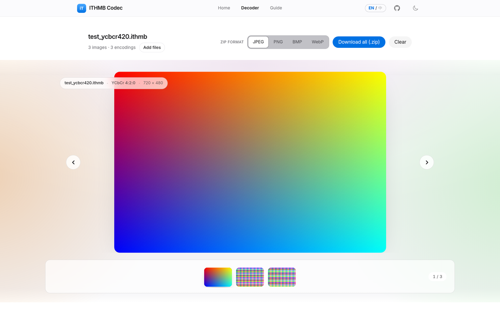

<div align="center">


# ITHMB Codec Web

[](LICENSE)
[](https://webassembly.org/)
[](https://buymeacoffee.com/ThumbNami)

Free, private, browser-based .ithmb file decoder.

[**Try it live → ithmb-codec.dev**](https://ithmb-codec.dev/ithmb-decoder/) | [How to open .ithmb files (guide)](https://ithmb-codec.dev/guide/how-to-open-ithmb-files)

<picture>
  <source media="(prefers-color-scheme: dark)" srcset="docs/screenshots/decoder-ui-dark.svg">
  
</picture>

<sub>Built with AI assistance — see <a href="./docs/CREDITS.md">CREDITS.md</a></sub>
<br>
<a href="./docs/CREDITS.md"></a>
<a href="./docs/CREDITS.md"></a>
<a href="./docs/CREDITS.md"></a>

<br>
</div>

ITHMB files are Apple iThumbnail images found in iPod Classic, iPod Nano, and other legacy Apple devices — thumbnail-sized album art, photos, and menu graphics that the iPod's UI reads directly from its disk. The format is undocumented and varies across devices and firmware versions. This project decodes them in your browser via WebAssembly, powered by [ithmb-core](https://crates.io/crates/ithmb-core) from the parent repo [ithmb-codec](https://github.com/B67687/ithmb-codec).

## Features

- **Free.** No cost, no signup, no account needed.
- **Private by default.** Everything runs in your browser via WebAssembly. Files are
  never uploaded during decoding or download. The only network calls are same-origin
  assets. There is no upload or contribution endpoint.
- **Batch decode.** Decode multiple .ithmb files at once.
- **Fast, honest loading.** The WASM fetch starts at navigation; progress appears
  after 2 s, and a stalled init shows one failure panel with Retry (7 s
  module-graph / 15 s init watchdog) instead of a spinner.
- **Remembers your choices.** Theme and language choices persist; an explicit
  theme choice is pinned against OS changes.
- **Open source.** MIT licensed. Fork it, audit it, improve it.

## Architecture

```
Static shell (built once by src/shell.ts: nav, footer, skip link)
  pages: index.html, 404.html, guide/, privacy/, third-party-notices.html, zh/
  classic scripts: src/theme.ts, src/nav.ts, src/footer.ts, src/404-lang.ts,
                   guide/guide.ts, privacy/toc.ts -> assets/js/*.js
  registries: src/routes.ts (pages/sitemap/redirects),
              ithmb-decoder/formats.ts (export formats)

Decoder page
  head boot:  src/decoder-boot.ts (single WASM fetch, progress)
              src/decoder-watchdog.ts (7 s graph / 15 s init failure panel)
  app:        app.ts -> ui.ts, decoder.ts, viewer.ts, cards.ts, download.ts
              decoder.ts -> decode-pipeline.ts -> ithmb_wasm_bg.wasm
              i18n.ts (en/zh + locale.ts), formats.ts (export formats),
              profiles.ts (generated), limits.ts

Build: TS -> JS (classic scripts to assets/js/), shell render, sitemap/_redirects,
       fflate bundle, ?v= content hashes
Deploy: bun run build:pages -> _site/ (89 files) -> Cloudflare Pages direct upload
```

The served site is the curated `_site` artifact, not the repository root.
See `ARCHITECTURE.md` for the module map, current release facts and deployment,
and `docs/SOURCE-PUBLISH.md` for the mirror invariant.

## Quick Start

```bash
bun install              # install dependencies
bun run build            # compile TS → JS, render shell, generate sitemap/_redirects, stamp ?v= refs
bun run serve            # serve at http://localhost:8899
```

Open http://localhost:8899 and drag a .ithmb file onto the decoder page.

### Essential scripts

| Script                | Purpose                            |
| --------------------- | ---------------------------------- |
| `bun run build`       | Compile TS sources to JS           |
| `bun run build:pages` | Build the curated `_site` artifact |
| `bun run serve`       | Local dev server (:8899)           |
| `bun run test:quick`  | Fast single-browser check (Tier 1) |
| `bun run check:local` | Full local CI (10 gates)           |
| `bun run test:unit`   | Unit tests via bun (Tier 0)        |
| `bun run test:extensions` | Local content-blocker compatibility check |
| `bun run probe:post-deploy` | Probe a deployed host (pass the URL) |

Full list: `package.json` `scripts` (single source of truth).

## Local vs GitHub CI

Local-first: local runs everything hardware allows; GitHub covers the rest.
Single-sourced in [ARCHITECTURE.md](ARCHITECTURE.md) (gate matrix) and
[docs/TEST_STRATEGY.md](docs/TEST_STRATEGY.md) (tiers and time budgets).

CI coverage: the workflow runs on pushes to `main`, `release` and
`redesign/apple-tiles`, plus PRs and manual dispatch. CI Playwright uses retries 1
(locally 0), the a11y gate enables `color-contrast`, and the decoder/theme/TOC
specs poll data-state hooks instead of fixed waits.

## How to use

Go to [https://ithmb-codec.dev/ithmb-decoder/](https://ithmb-codec.dev/ithmb-decoder/) and drag your .ithmb files
onto the page. They decode instantly — no upload, no waiting. Download individual
images or grab them all as a ZIP archive.

## Deployment

The site is static: `bun run build:pages` creates `_site/` (89 files at the
current release), which is uploaded directly to Cloudflare Pages with
`--commit-dirty=true`; there is no server-side processing and no Pages build
step. A deploy is proven on a preview with the 72-check
`scripts/post-deploy-probe.mjs` before the custom domain is re-added. The
operational procedure, provenance record and rollback live in the dev
repository's runbook (not mirrored). The public repository is a source mirror
with one orphan commit and tag `v2.0.0` (`docs/SOURCE-PUBLISH.md`).

## Documentation

- [**ARCHITECTURE.md**](ARCHITECTURE.md) — System context, current release facts, module map, gates, and deployment path
- [**SPECIFICATION.md**](SPECIFICATION.md) — As-built specification: states, contracts, quality gates
- [**docs/DECISIONS.md**](docs/DECISIONS.md) — Why the project is built this way (canonical decision record)
- [**docs/FEATURES.md**](docs/FEATURES.md) — Feature inventory with F-### lifecycle, behavior contracts, and test anchoring
- [**docs/DESIGN.md**](docs/DESIGN.md) — Design system: tokens, themes, fonts, components, breakpoints
- [**docs/TEST_STRATEGY.md**](docs/TEST_STRATEGY.md) — Test tiers, budgets, CI gates, and the bug-link rule
- [**docs/SOURCE-PUBLISH.md**](docs/SOURCE-PUBLISH.md) — Source-mirror allowlist and publish invariant
- [**docs/CREDITS.md**](docs/CREDITS.md) — AI tooling credits

## Support

The site is maintained by Nami.

Found an .ithmb file that doesn't decode? [Open an issue on the codec repo](https://github.com/B67687/ithmb-codec/issues).

Enjoying the tool? [Buy me a coffee](https://buymeacoffee.com/ThumbNami).

## Built with

Rust, WebAssembly, and TypeScript.

## License

MIT — see [LICENSE](LICENSE). Free to fork, audit, and improve.

Third-party components keep their own licences. The copyright and licence
notices for fflate, Inter, wasm-bindgen and ithmb-core are on the
[third-party notices page](third-party-notices.html) (served at
`/third-party-notices`, with a Chinese translation at `/zh/third-party-notices`);
the Inter font's SIL OFL 1.1 text is in
[OFL.txt](OFL.txt).

The bundled sample file and the test fixtures are synthetic colour-bar
patterns generated for this project, released under the MIT license. No
third-party photographs or device dumps are included.
